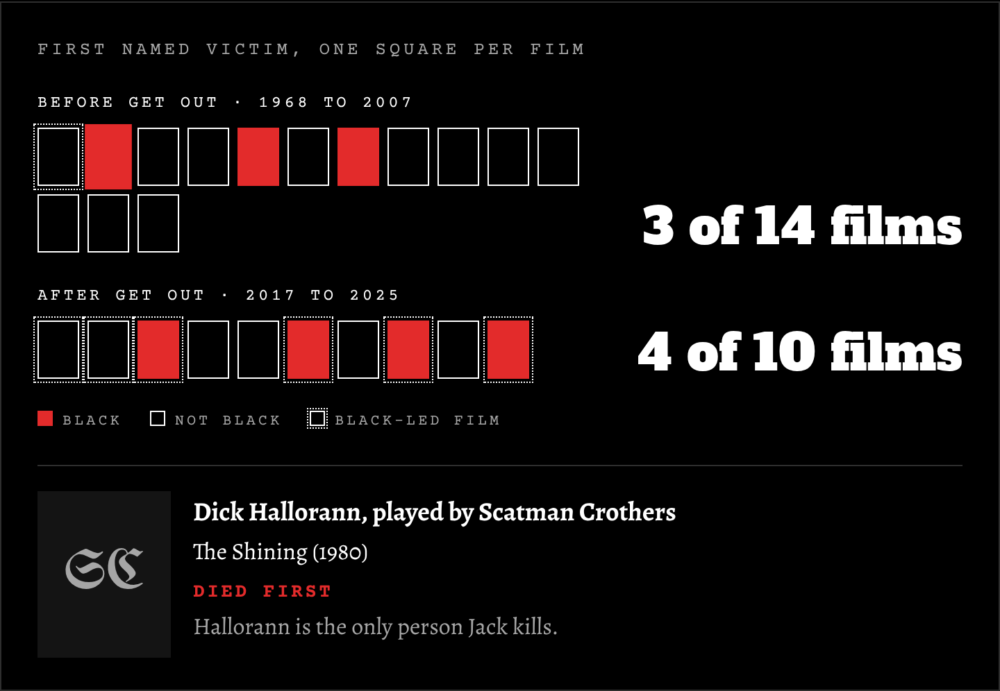
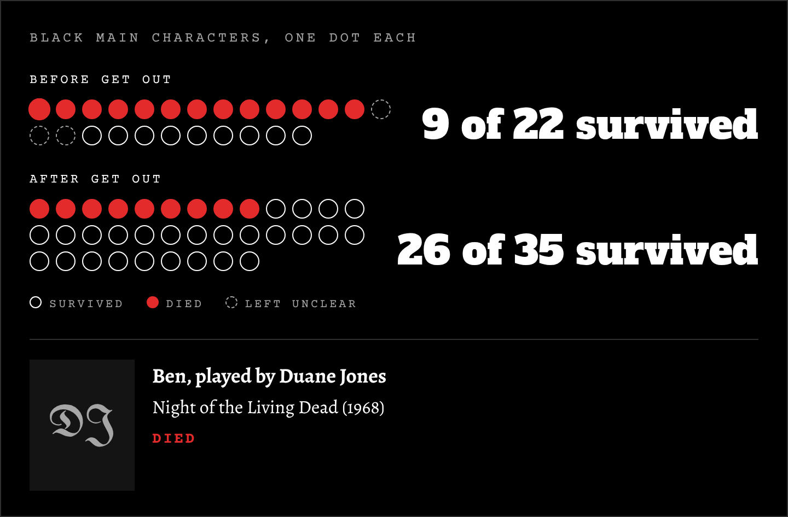
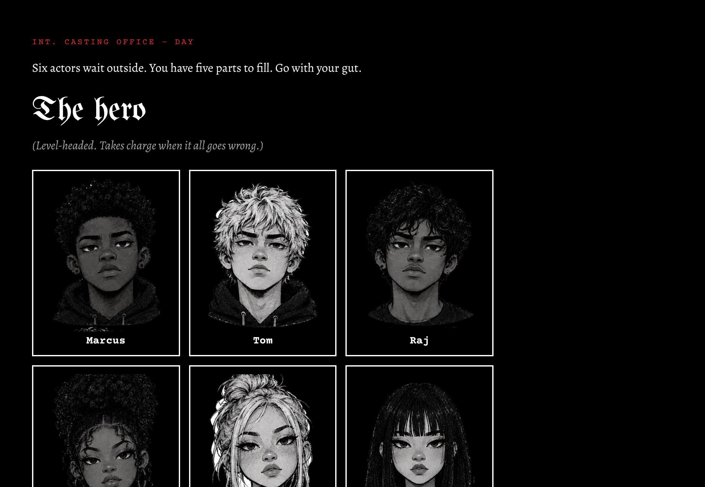

# Who Dies First? Black Characters in Horror, 1968–2025 🔪

An interactive horror game and data story about one of cinema's oldest jokes: *the Black character always dies first.* Players cast their own horror film, decide who dies, and then see how their choices compare with what 27 real horror films actually did.

🔗 **[Play the game](https://georgiajayy.github.io/black-horror-1968-2025/)**

✅ **Status:** Live. Made for Black History Month, October 2026.


## About the project

Everyone has heard the joke that the Black character dies first in horror films. It's repeated so often that it feels like a fact. But is it actually true? And if it isn't, why does everyone remember it that way?

This project tests the trope against the data. I went through 27 well-known horror films from *Night of the Living Dead* (1968) to *Sinners* (2025), and logged who dies first and what happens to every Black main character. The findings are wrapped in a short game: you cast six actors into classic horror roles, choose who dies, and then the game shows how your gut instincts compare with Hollywood's track record, followed by a history of Black horror and an analysis of what the numbers mean.

## Why I built this

I moved into data from a background in media production. For my second monthly project I wanted to do something about culture, and October, which is both Black History Month in the UK and the month of Halloween, made Black horror the obvious choice.

I also wanted to build something more than a dashboard. A game lets people test their own assumptions before they see the data, which makes the finding hit harder. The design follows the same visual identity as the rest of my portfolio: black and white, gothic type and red accents.

## Guiding questions

1. In horror films, was the first named victim really Black as often as the joke suggests?
2. Did Black characters survive less often than the joke implies, or more?
3. Did anything change after *Get Out* (2017)?
4. Where did the trope come from, and what does the history of Black horror say about it?

## Key findings

### 1. The joke is mostly a myth



Before *Get Out*, the first named victim was Black in only 3 of 14 films: *The Shining*, *Candyman* and *Scream 2*. Two of those are among the most famous horror films ever made, which may be why the joke feels so true.

### 2. The real pattern was survival, not dying first



Dying first was rare, but surviving was rarer. Before 2017, only 9 of the 22 Black main characters whose fate is clear made it to the end. They tended to be the sidekick, the soldier or the helper, who die saving someone else. After *Get Out*, 26 of 35 survived.

### 3. After *Get Out*, it only happens in Black-led films

From 2017, the first victim was Black in 4 of 10 films, and all four (*His House*, *Nope*, *The Blackening* and *Sinners*) are Black-led, where most of the cast is Black. In the other six films, the first victim was white.

### 4. Who tells the story decides who survives

The film scholar Robin R. Means Coleman separates *Blacks in horror* (Black characters placed in stories that aren't about them) from *Black horror* (films by Black creators about Black life). The rise in survival lines up with that shift. Black characters began to survive when Black writers and directors started telling the stories.

## The game

The game has three parts:

1. **Casting:** six actors, five parts (the hero, the final girl, the best friend, the jock and the one who checks the noise). Go with your gut.
2. **The film:** three scenes in a cabin. Pick who dies first, who dies next and who makes it out.
3. **The reveal:** your film compared with the real films. Tap any square or dot to see the character, the actor and their fate. Then there's a short history of Black horror in five eras, an analysis of the numbers and a watchlist.



## Data and methods

**Films:** 27 well-known horror films with Black characters in the main cast, 15 from before *Get Out* (1968–2007) and 12 from after (2017–2025).

**Source:** each film's plot summary on Wikipedia, linked in `data/films.csv`. Everything was logged by hand.

**Actor photos:** loaded live from Wikipedia, and only shown when the photo is freely licensed on Wikimedia Commons.

**Key measures:**

- **First named victim:** the first named, credited character to die in the film's story.
- **Black main character:** a main character played by an actor who is publicly identified as Black.
- **Survival:** whether a character is alive at the end of the film.
- **Black-led film:** a film whose lead or main cast is mostly Black.

**Choices and assumptions:**

- Villains and monsters are not counted as victims. For example, the Tethered doubles in *Us* are counted as villains.
- Characters whose fate is left unclear (three, all before 2017) are shown on the chart but not counted in the survival figures.
- Three films (*Alien vs. Predator*, *Get Out* and *Candyman* 2021) are left out of the "who died first" count because the source doesn't make the first victim clear.
- Where an actor's identity wasn't clear from public sources, they were left out rather than guessed.

## Limitations

This is a hand-picked set of 27 films, not a random sample of every horror film ever made. The films after 2017 lean towards Black-led stories, which is part of the story but also shapes the survival figures. The numbers describe these films, not the whole genre. Plot summaries can be incomplete, so a few death orders could be off by a place.

## Tools and technologies

| Tool | What it's used for |
| --- | --- |
| Python | Building the page from the CSV data (`src/build.py`) |
| CSV | Storing the hand-logged film and character data |
| HTML and CSS | The page layout, the typography and the black-and-white design |
| JavaScript | The game logic, the charts and the actor photo cards |
| Wikipedia REST API | Loading freely licensed actor photos |
| Playwright | Testing the game in a browser on desktop and mobile |
| Git and GitHub Pages | Version control and hosting the live game |

## Project structure

```
black-horror-1968-2025/
├── index.html                  # The game (built by src/build.py)
├── src/
│   ├── template.html           # The game's HTML, CSS and JavaScript
│   └── build.py                # Puts the CSV data into the template
├── data/
│   ├── films.csv               # One row per film, with its first named victim
│   └── black_characters.csv    # One row per Black main character, with their fate
├── assets/
│   ├── cast/                   # The six character portraits
│   ├── fonts/                  # Self-hosted fonts and their licences
│   └── logo.png                # My logo
├── screenshot_title.png        # Title screen
├── screenshot_casting.png      # Casting screen
├── chart_first_victim.png      # First victim chart
├── chart_survival.png          # Survival chart
└── README.md                   # You are here
```

## How to run it yourself

Clone the repository:

```
git clone https://github.com/georgiajayy/black-horror-1968-2025.git
cd black-horror-1968-2025
```

Start a local server and open `http://localhost:8000` in your browser:

```
python -m http.server 8000
```

If you change the data in `data/`, rebuild the page:

```
python src/build.py
```

## What I learned

The biggest lesson was how much the definitions matter. Before counting anything I had to decide what "first" means, who counts as a victim, what to do with villains, doubles and possessed characters, and how to handle actors with mixed heritage. Each of those choices could move the numbers, so I wrote them all down.

The data also corrected me. I expected to confirm the joke, but the real pattern was quieter and more interesting: Black characters weren't usually first to die, they just rarely made it to the end. Building a game rather than a dashboard also taught me to think about the order people meet the information in, so the reveal lands after they've made their own choices.

## Roadmap

- [x] Choose the project's focus (Black characters in horror)
- [x] Log the first victim and Black characters' fates for 27 films
- [x] Design the game: casting, scenes and the reveal
- [x] Write the history of Black horror and the analysis
- [x] Build the charts and the actor photo cards
- [x] Publish the game on GitHub Pages
- [ ] Future: expand the dataset to every wide-release horror film since 1968
- [ ] Future: let players' answers build a live dataset of what people expect

## Acknowledgements

- Robin R. Means Coleman, *Horror Noire: Blacks in American Horror Films from the 1890s to Present* (2011), and the 2019 documentary of the same name
- Wikipedia contributors, for the plot summaries
- The photographers on Wikimedia Commons whose freely licensed photos appear in the game
- Fonts: UnifrakturMaguntia, Alegreya, Alfa Slab One and Courier Prime, all under the SIL Open Font License

---

Georgia J Summers · Junior Data Analyst · [GitHub](https://github.com/georgiajayy) · LinkedIn · [YouTube](https://www.youtube.com/@datawithgeorgiajayy)
